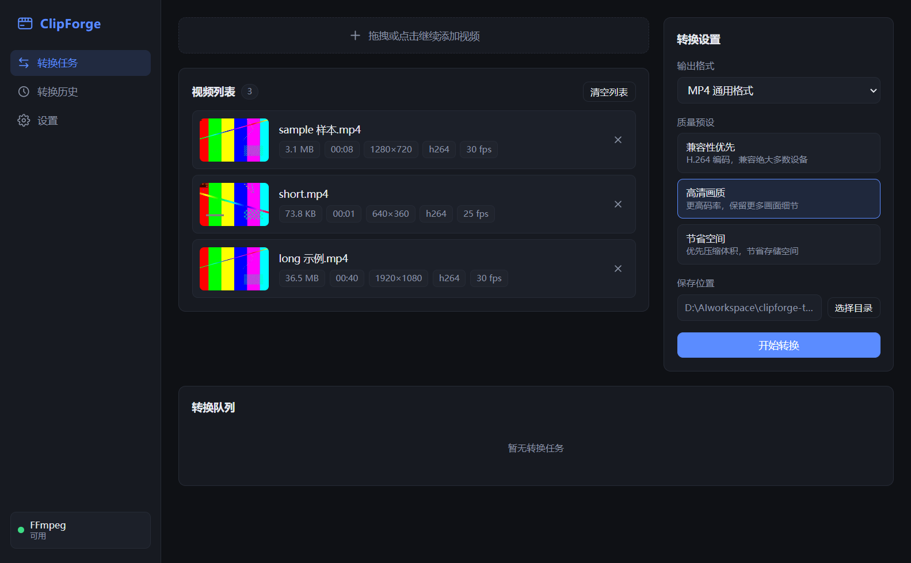
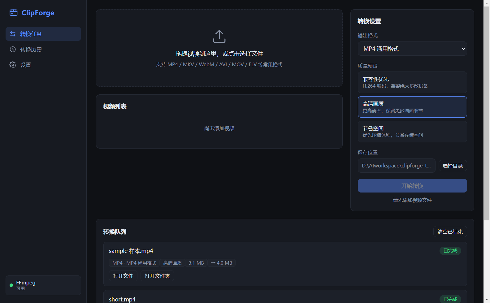
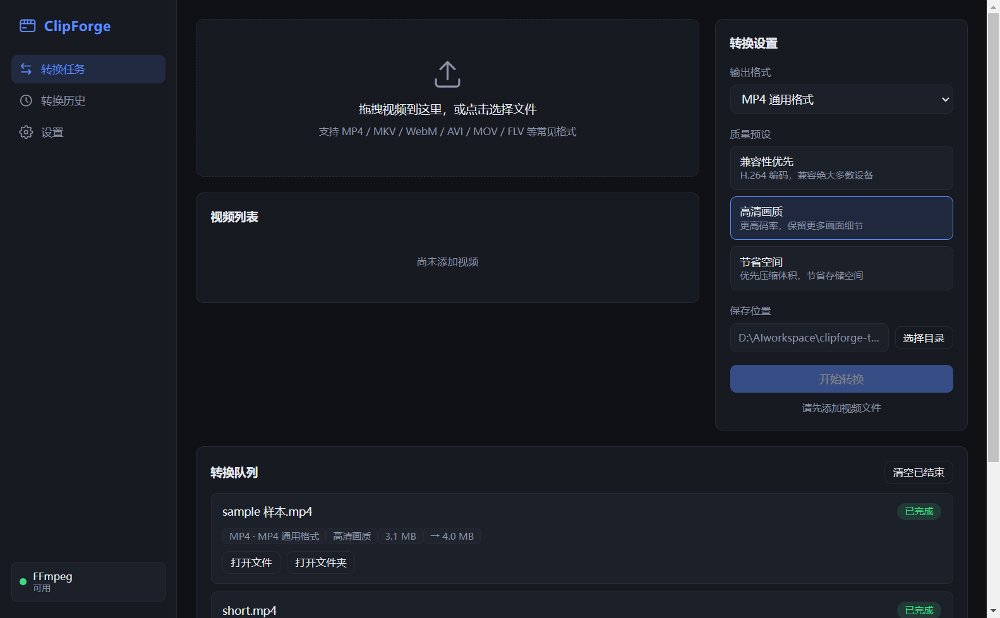
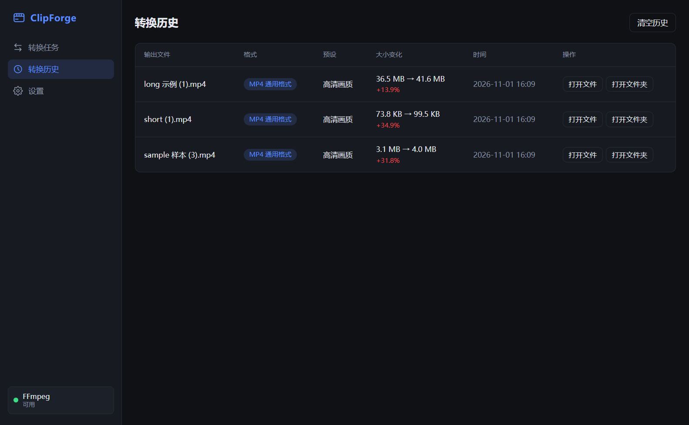
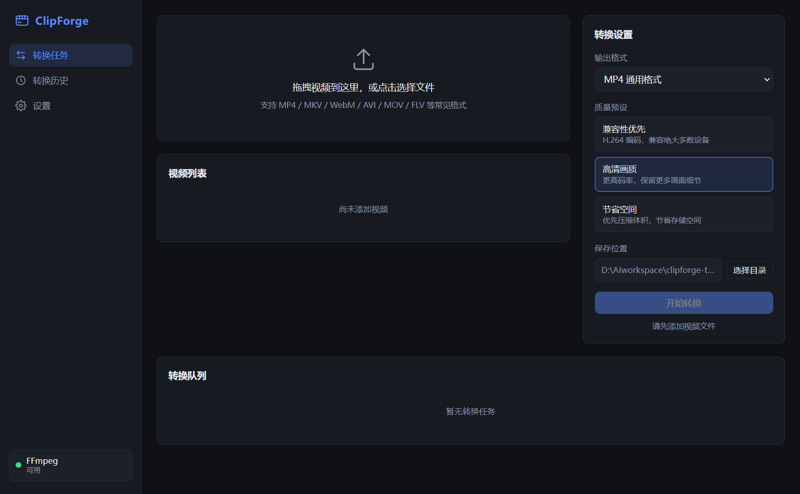
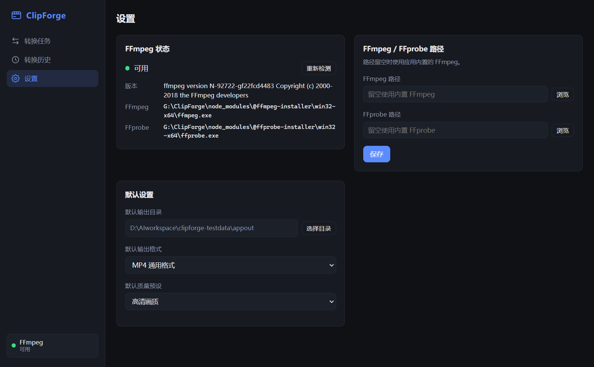

# ClipForge

A modern desktop video conversion studio for Windows.

ClipForge 是一款面向普通用户的本地视频格式转换工具：拖入视频、选择目标格式与质量预设、点击开始，剩下的交给真实的 FFmpeg 转码。不上传云端，不做网页套壳。

## Screenshots

| 导入与配置 | 真实转码进度 |
|---|---|
|  |  |

| 任务完成（前后对比） | 转换历史 |
|---|---|
|  |  |

| 空状态 | 设置 |
|---|---|
|  |  |

## Demo

待录制：30–60 秒真实操作录屏（打开应用 → 拖入视频 → 选择 MP4 通用预设 → 开始转换 → 进度 → 打开结果 → 播放）。本仓库不包含演示视频，避免以静态图片冒充实拍演示。

## Features

- **导入**：系统文件选择器或多文件拖拽（Electron `webUtils.getPathForFile`），支持 MP4 / MKV / MOV / AVI / WebM / WMV / FLV / M4V / TS / MPEG / 3GP / OGV。
- **真实媒体信息**：FFprobe 读取时长、分辨率、容器、视频/音频编码、帧率、码率；字段缺失时显示 `—`，不崩溃。
- **真实缩略图**：FFmpeg 按视频时长智能抽帧（`min(3s, duration/2)`），缓存在用户数据目录，失败时显示占位图。
- **格式转换**：MP4（H.264/AAC）、MKV（H.264/AAC）、WebM（VP9/Opus）；MP4 默认 `+faststart`。
- **智能预设**：兼容性优先 / 高清画质 / 节省空间（MP4 省空间使用 H.265）。
- **真实进度**：解析 FFmpeg `-progress pipe:1` 的 `out_time`/`speed`，绝不模拟进度；未知时长不伪造百分比。
- **串行任务队列**：Pending → Running → Completed / Failed / Cancelled，同一时间只运行一个任务。
- **取消**：终止真实 FFmpeg 子进程（`AbortController` → `child.kill()`），清理临时文件。
- **输出安全**：先写临时文件，FFmpeg 成功退出 + FFprobe 校验（视频流存在、时长 > 0）后才提交为最终文件；从不覆盖已有文件，自动生成 `名称 (1).mp4`。
- **完成操作**：打开输出文件 / 打开所在文件夹。
- **转换历史**：记录输出文件、格式、预设、转换前后体积变化（本地 JSON，最多 200 条）。
- **设置**：输出目录、默认格式/预设、自定义 FFmpeg / FFprobe 路径、可用性检测。

## Tech Stack

Electron 33 · Vue 3 · TypeScript · Vite 6 · Pinia 2 · FFmpeg/FFprobe CLI (`child_process.spawn`) · electron-builder · Vitest

## Architecture

```
Renderer (Vue 3 + Pinia)  ──window.api──▶  Preload (contextBridge whitelist)
        ▲                                          │ IPC
        │ task:update events                       ▼
        └──────────────────────────── Main process ────────────────────────────┐
                                     │  ffmpegLocator · mediaService           │
                                     │  thumbnailService · conversionService   │
                                     └─ taskManager (serial) · AppStore        │
                                                │ spawn(argv[], no shell)
                                                ▼
                                          FFmpeg / FFprobe
```

- `contextIsolation: true`，`nodeIntegration: false`，`sandbox: true`，渲染进程无法直接访问文件系统。
- IPC 输入全部校验（字符串、绝对路径、枚举值）；FFmpeg 永远以参数数组启动，绝不拼接 shell 命令。
- 详见 [`docs/ARCHITECTURE.md`](docs/ARCHITECTURE.md)。

## Download

- 源码：本仓库。
- Windows x64 安装包：`release/ClipForge Setup 1.0.0.exe`（electron-builder 生成，未签名）。
- 校验信息：见 Release 说明或 `Get-FileHash` 自行核对。

## Installation & Usage

```bash
npm install
npm run dev        # 开发模式（Vite dev server + Electron）
npm test           # Vitest 单元测试
npm run build      # 编译主进程 + 构建渲染进程
npm run dist       # 生成 Windows NSIS 安装包 → release/
```

安装后直接启动 `ClipForge`。首次使用：

1. 将视频拖入窗口，或点击选择文件。
2. 在右侧选择输出格式与质量预设，按需更改保存位置。
3. 点击「开始转换」，在底部任务队列查看真实进度，可随时取消。
4. 完成后点击「打开文件」或「打开文件夹」。

FFmpeg/FFprobe 默认使用应用内置二进制（打包后位于 `resources/bin`）；如内置版本不适合你的素材，可在「设置」中指定自己的 `ffmpeg.exe` / `ffprobe.exe`。

## AI-Assisted Development

本项目按三天开发规划由 AI 编码 Agent 在开发者（李佳）的指令下实施，并使用多个子 Agent 分工协作：

| 角色 | 输出 |
|---|---|
| UI/UX + Renderer Agent | `src/renderer/**` 全部界面、Pinia store、深色设计系统 |
| FFmpeg Engineering Agent | 用真实二进制验证进度字段、编码器、抽帧、取消、输出校验 |
| 主 Coding Agent | 主进程服务、Preload、IPC、任务队列、测试、打包、文档 |

真实协作记录（包括 AI 的误判、被否决的方案、测试证据）见 [`docs/AI_SESSION_SUMMARY.md`](docs/AI_SESSION_SUMMARY.md)，技术决策见 [`docs/DECISIONS.md`](docs/DECISIONS.md)。

## Testing

- `npm test`：32 个 Vitest 单元测试（进度解析、媒体信息解析、FFmpeg 参数与命名冲突、任务队列状态机）。
- `node scripts/smoke-conversion.cjs <testDataDir>`：真实 FFmpeg 转换冒烟测试（5 种格式/预设组合、无音轨、重名、损坏文件、取消）。
- `node scripts/e2e-app-check.mjs <testDataDir> <outDir>`：针对运行中的真实应用做 IPC + FFmpeg 端到端检查（需先以 `--remote-debugging-port=9222` 启动）。
- 已执行的结果与未执行项见 [`docs/TEST_PLAN.md`](docs/TEST_PLAN.md)。

## License & FFmpeg Notices

- 项目代码：MIT（见 `LICENSE`）。
- FFmpeg/FFprobe 二进制通过 npm 包 `@ffmpeg-installer/ffmpeg@1.1.0` 与 `@ffprobe-installer/ffprobe@2.1.2` 获取，打包时复制到安装目录 `resources/bin`：
  - `ffmpeg.exe`：`N-92722-gf22fcd4483`（2018-12，GPL 构建，含 libx264/libx265/libvpx/libopus 等）。
  - `ffprobe.exe`：`2023-02-13-git-2296078397-essentials_build`（gyan.dev essentials 构建）。
  - 两者版本不一致，但已实测可协同工作。分发时请遵守 GPL/LGPL 条款并保留对应来源说明。
- 替换为自己的 FFmpeg 构建时，请确认包含 `libx264`、`libx265`、`libvpx-vp9`、`libopus`、`aac`。

## Known Limitations

- 仅支持 Windows x64；安装包未做代码签名（SmartScreen 可能提示）。
- 串行转换，无并发；不支持 GPU 硬件编码。
- 文件中部数据损坏的源视频可能被 FFmpeg 容错解码为“成功”，仅截断/无 moov 等结构性损坏会被拦截。
- 不支持字幕/多音轨保留（当前只映射首条视频流和首条音轨）。
- 未在干净的独立 Windows 机器上执行安装测试（见 TEST_PLAN 未执行项）。
- 演示视频尚未录制。
